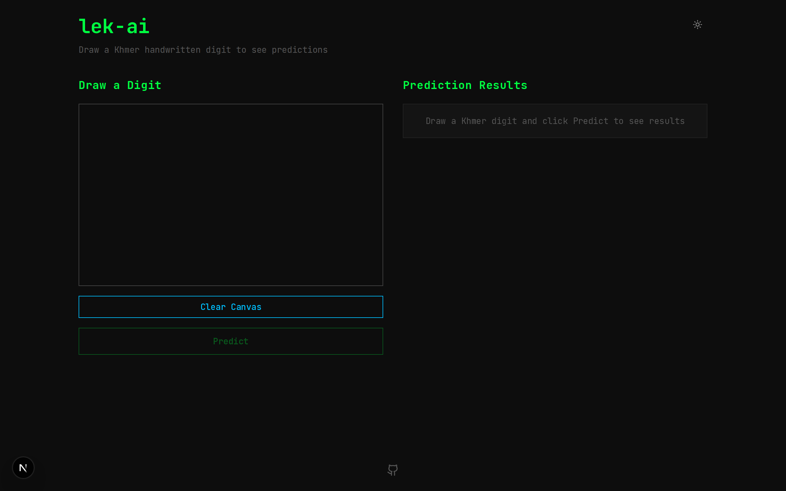
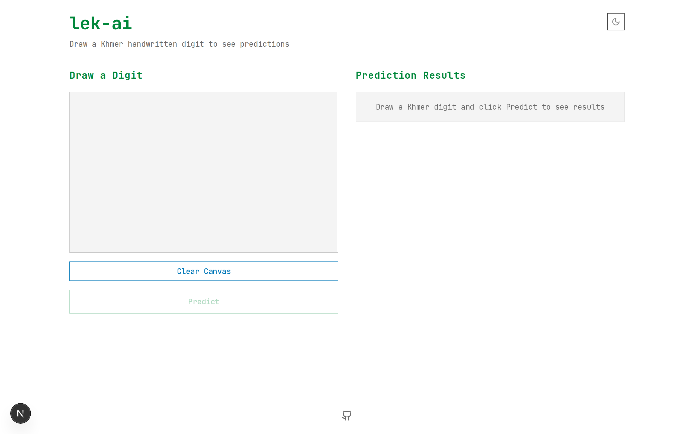

# lek-ai


Draw a Khmer handwritten digit (០–៩) on a canvas and recognize it with a bidirectional GRU model. **Everything runs in the browser** — the model is downloaded once and inference happens locally with WebAssembly. No backend, no server, deployable as a static site.

## Demo

<p align="center">
  
  
</p>

## Getting started

```bash
cd frontend
npm install
npm run dev
```

Open `http://localhost:3000`. On first load the app fetches `best_gru_model.onnx` (16.55 MB, served from `public/`) and the WebAssembly runtime; after that every prediction runs entirely client-side.

## How it works

1. You draw strokes on the canvas; points are recorded as canvas `[x, y, ...]` pairs.
2. On **Predict**, `frontend/lib/predict.ts` flattens the strokes, min-max normalizes x and y independently to `[0, 1]`, and packs them into rows of 16 floats (zero-padded at the end).
3. The `(1, rows, 16)` tensor goes through the ONNX model (bidirectional GRU + attention) in `onnxruntime-web` (WASM, single-threaded — no cross-origin-isolation headers needed).
4. The argmax over the 10 logits maps to a Khmer numeral via `String.fromCharCode(0x17e0 + digit)`.

## Project structure

```
frontend/
  app/                 Next.js app router (page, layout, styles)
  components/          Canvas drawing, prediction display, theme toggle
  lib/predict.ts       In-browser inference: preprocessing + ONNX session
  public/
    best_gru_model.onnx  Exported model (downloaded by the browser)
    ort/                 ONNX Runtime Web WASM files
tools/                 Model export tooling only — not a server
  model/               DeepGRU model definition + weight loader
  best_gru_model.pth   Trained model weights
  export_onnx.py       .pth -> ONNX export + torch/ORT parity check
```

## Updating the model

```bash
cd tools
uv sync
uv run python export_onnx.py
```

This re-exports `best_gru_model.pth` to `frontend/public/best_gru_model.onnx` and fails unless the ONNX output matches PyTorch's (max logit diff < 1e-3, argmax equal across sequence lengths 16–411).

## Credits

The model is based on research conducted in 2025 at the Institute of Technology of Cambodia.

**Team:** Pel Bunkhloem, Pho Rotha, Phoeurn Kimhor, Ty Kana, Va Seyha, Yin Sambat

**Advisor:** Dr. Ngin Kimlong
